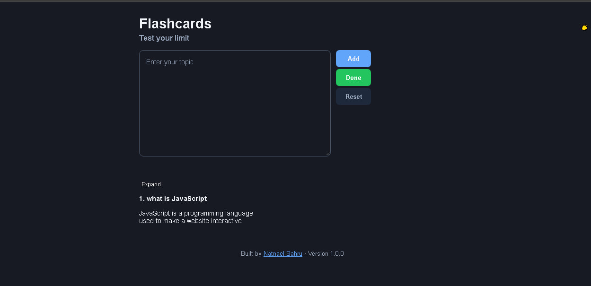
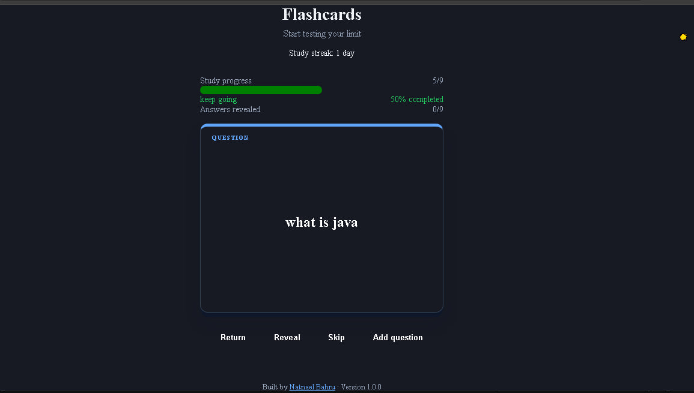

# Flashcards

A simple app for creating flashcards and testing yourself. Cards are saved in your browser, and the app includes dark mode, quiz progress, and optional AI answer suggestions.

## Screenshot

## Features

- Create and delete flashcards
- Quiz yourself with Reveal, Skip, and Return
- Track your position through the deck
- Save cards in your browser
- Switch between light and dark mode
- Get optional AI answer suggestions

## Tech stack

HTML · CSS · JavaScript · Node.js · Express · Google Gemini API

## Run locally

1. Open frontend/index.html with VS Code Live Server.
2. To use AI suggestions, open a terminal in backend/ and run:

  
   npm install
   
3. Add your Gemini API key to backend/.env:

  
   GEMINI_API_KEY=your_api_key_here
   
4. Start the backend:

  
   npm start
   
Keep your API key private.

## About

This is version 1 of my flashcard app and a project I’m building while learning web development. Future improvements may include user accounts and syncing cards across devices.